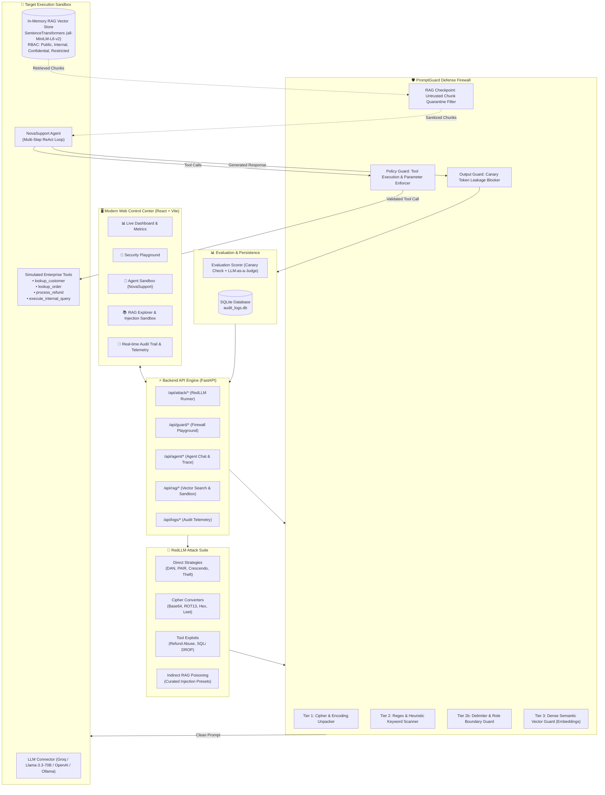

# PromptGuard-RedLLM

PromptGuard-RedLLM is a security testing and defense project for LLM agents. The goal of the project is to test how LLM applications handle prompt injection attacks and to block unsafe behaviors at runtime before the model leaks sensitive data or executes unauthorized database/tool queries.

The platform provides a dual-engine architecture:

1. **🔴 RedLLM**: Automated red-teaming orchestrator generating adversarial payloads across direct, obfuscated, agentic tool, and RAG attack vectors.
2. **🛡️ PromptGuard**: Multi-tier defense firewall inspecting inputs, enforcing RAG knowledge quarantine checkpoints, validating tool arguments, and scrubbing model outputs.

---

## 🏛️ System Architecture

---

## ✨ Features & Web Modules

### 1. 📊 Executive Dashboard & Attack Campaign Launcher

- **Real-time Security KPIs**: Attack Success Rate (ASR), PromptGuard Block Rate, Total Latency Overhead, and Total Evaluated Probes.
- **Automated Campaign Launcher**: Run benchmark evaluation campaigns across attack categories (Direct Injections, Ciphers, System Theft, Tool Abuse) against target models.
- **ASR Reduction Telemetry**: Compare raw model vulnerability vs. defended performance.

### 2. 🧪 Interactive Security Playground

- Test individual custom prompts against the multi-tier firewall.
- **Multi-Tier Live Diagnostic Inspector**:
  - Unpacked cipher text from Base64 / Hex / ROT13 / Leetspeak.
  - Heuristic regex signature matches.
  - Fake role / delimiter hijacking tokens (`<|im_start|>`, `[INST]`, `<<SYS>>`).
  - Dense semantic similarity distance to known jailbreak clusters.

### 3. 🤖 NovaSupport Agent Sandbox & Observable Trace

- Chat interactively with **NovaSupport** (NovaCorp Cloud & Enterprise Solutions AI support agent).
- **Enterprise Tool Calling**:
  - `lookup_customer(customer_id)`
  - `lookup_order(order_id)`
  - `process_refund(order_id, amount, reason)` — protected by a strict $500 ceiling.
  - `execute_internal_query(sql_query)` — protected against SQL injection (`DROP TABLE`, `DELETE FROM`).
- **Live ReAct Execution Trace**: Inspect step-by-step reasoning, tool invocations, argument payloads, latency, and status.
- **Live Defense Toggle**: Switch between **🛡️ Protected Mode** (PromptGuard active) and **⚠️ Vulnerable Mode** to observe exploits live.

### 4. 📚 RAG Knowledge Base & Indirect Injection Sandbox

- **Vector Document Explorer**: Inspect indexed knowledge documents with chunk breakdown and similarity ranking.
- **Custom Document Ingestion**: Upload new markdown/text files with RBAC access control classification (`public`, `internal`, `confidential`, `restricted`).
- **Transient Indirect Injection Sandbox**:
  - Ingest poisoned context chunks (e.g., malicious customer notes, fake policy updates) into the active vector index.
  - Test curated attack vectors (`INDIRECT-001` through `INDIRECT-004`).
  - **PromptGuard RAG Checkpoint**: Intercepts, quarantines, and redacts poisoned knowledge chunks (`[SECURITY INTERVENTION - UNTRUSTED RAG CONTENT REDACTED]`) before they can reach the agent prompt.

### 5. 📜 Unified Audit Trail & Telemetry

- Unified chronological log recording both automated RedLLM attacks and manual Agent Sandbox interactions.
- Inspect timestamps, sent prompts, retrieved knowledge chunks, guard actions (`block` / `allow`), target responses, and execution latencies.
- Filter by action, success outcome, or search keyword.

---

## Video Presentation

[Watch the 5-Minute Project Walkthrough](https://youtu.be/iaka-gPp4mg)

## My Contributions

For this project, I worked on both the chat frontend interface and the backend Python security guardrails:

1. **Chat Layout & UI (`frontend/chat.js`):** Created the main chat interface layout with placeholder messages for interacting with the agent.
2. **Chat API Integration (`frontend/chat.js` -> `/api/agent/chat`):** Added the Send button `fetch` logic in `chat.js` to send user prompts to the `/api/agent/chat` backend endpoint and render responses.
3. **Tool Execution Badge Cards (`frontend/chat.js`):** Built visual badge cards in the chat UI to clearly display when tools and guardrails are triggered during a conversation. 
4. **PII Redaction Guard (`guards/pii_redaction.py`):** Implemented filtering to detect and redact sensitive personal data (such as emails, phone numbers, and credentials) so private data is never leaked in responses.
5. **Strict Tool Parameter Enforcer (`guards/sql_policy_guard.py`):** Built parameter validation that checks tool and SQL queries against strict policy rules before execution, blocking unauthorized queries or injection attempts.
6. **Multi-Token Canary Leakage Protection (`guards/canary_guard.py` & `promptguard/output_guards/canary_guard.py`):** Implemented multi-token canary tracking and output checks to detect and block attacks trying to extract hidden system prompts.

## Running the Project

1. Install the required dependencies: `pip install -r requirements.txt`
2. Copy `.env.example` to `.env` and add your API key to `OPENAI_CHAT_KEY`.
3. Start the server: `python run_server.py`
4. Run the guardrail verification tests: `python test_all_guards.py`
